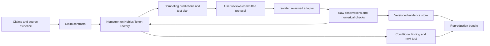

# CounterLab

**October 26 claim-audit update:** Sources now opens five developer-framed
questions with deterministic answers derived from sealed study, source-slice and
model-evaluation records. Exact record-field citations, comparability states,
explicit unknown coverage, bounded conclusions and missing-evidence steps are
inspectable and exported. Saved audits are rederived from verified records;
self-hashes do not authorize changed conclusions. Optional upstream-file identity
is an environment context, distinct from the selected local comparison rows.
All 211 offline Python tests, 12 frontend checks and both builds pass. No new
inference, numerical protocol changes or general research verdict.

**October 25 editable-workbench update:** A separate human-designed synthetic
workbench exposes bounded cache size, request family/length, seeds, laboratory
forecasts, budget reset and precommitted predictions. Its local calculator uses
the unchanged pinned kernel; complete records replay with a standard-library
Python zipapp. Portable browsing prepares plans only. These results are outside
the frozen benchmark and long source slice. All 201 offline Python tests and
12 frontend tests pass. Editable synthetic experimentation is improved; full
source fidelity, model advantage and v2 live quality remain open.

**October 25 guarded-workflow update:** Source investigator v2 now applies the
input-only prediction reviewer after commitment and before any worker launch.
A rejected prediction produces a decision and feedback, never an observation.
The model may select an untried follow-up within the same two-call allowance.
The underlying numerical task, frozen v1 planner, kernels, worker and historical
benchmark files remain unchanged. New v2 starts use a separate consent route;
request IDs cannot silently switch versions or spend twice.

Each new record binds the initial prompt, request ledger, captured responses,
contract decision, mathematical review, execution decision and follow-up feedback.
The verifier recomputes these decisions, all accepted measurements and the factual
report. Truncation and provider/worker failures stop without a retry; prior valid
measurements remain available, and partial failed outputs are not observations.
A standard-library portable replay verifies the same sequence offline.

162 offline tests, production build and a real restricted-worker integration pass.
The saved v2 example is clearly labelled simulated planning, with one blocked
repeat prediction followed by a measured 150,000-request history intervention.
This validates integration, not real-model performance. The separate guided tour
and retrospective audit remain available. V2 model quality, full G1, G2/model
advantage and external judge access remain unestablished. Earlier entries follow.

**Source-linked planning integrated:** The validated original-scale source slice
now has its own two-turn investigator, repeat control and admission checks.
Predictions are saved before execution; two isolated replays and a host check
admit measurements. The factual report separates target evidence from controls
and preserves every measurement. Its saved simulated-planning example and full
portable replay pass, alongside 107 offline tests and the build. Live performance
of this source prompt remains untested. Eight new source-derived tasks are frozen
without outcomes; isolated evaluation preparation and a new approved batch are
still required. G2/model advantage and full G1 are not declared complete.

**Selected source regime now reconstructed:** A preregistered supporting E4 slice
at k=16 and 150,000 requests reproduces three published aggregates (OPT, ratio
mean and std) with zero observed residuals. Thirty profiles cover two source
algorithms and a matched history-only intervention across ten shared-input
algorithm seeds; two isolated replays and a host replay agree. The history change
adds 247–285 misses in this regime. The UI and complete portable replay expose
all results. This establishes a bounded source-slice fidelity result, not full
official implementation parity or the overall published disagreement. The
experiment was developer-selected and makes no new autonomous planning claim.
Current gate: 92 tests and the build pass; no new inference was used.

**Reporting change after the frozen evaluation:** Production version 5 assigns
Nemotron experiment selection and proposed hypotheses. Deterministic reporting
owns factual counts, complete citations and finite conclusion labels. New runs
allow at most two planning calls and make no final reporting call. Every
accepted observation, including nulls, remains in the report and replay; old
model answers and scores are preserved. All 92 tests and two real Docker
recovery paths with simulated inference pass. The retrospective integration
check covers 32 records and 42 observations; it does not establish new model
accuracy or planning advantage. Version-5 live inference has not been run.
G1 and the original evaluation outcome remain unresolved.

**Current update, October 24:** The local app, isolated worker, finite source study, independent mathematical validator and frozen eight-task agent benchmark are implemented. All 92 tests and the interface build pass. The validator matched 161,872 events. The benchmark used 36 approved calls and 240,279 reported tokens: adaptive found 2/2 available differences, fixed-plan 1/2, heuristic/random both 2/2. Fully correct scoped model findings were adaptive 3/8 and fixed-plan 1/8, with two truncations preserved. This does not establish agent superiority or satisfy autonomous reporting targets. Original model answers remain visible beside separately checked interpretations; downloads recompute measurements and scores without inference. G1, broader validation, judging access and submission assets remain open. Earlier dated status is historical; performance requirements below remain prospective.

## Product requirements document — v0.1

**Date:** October 16, 2026.  
**Status (updated October 24):** Local product and replay infrastructure work; the small frozen diagnostic provides limited positive selection evidence and substantial reporting failures. There is no demonstrated selection advantage over the strongest simple baseline. External source-protocol parity, a qualifying full disagreement investigation, general agent contribution, final model ranking, demand validation and judging deployment remain unestablished.  
**Track:** Best Apps and Agents.  
**Tagline:** Turn disagreement into experiments.  
**Submission target:** October 29; official deadline October 30, 2026, 10 a.m. PDT / 1 p.m. EDT.

Read the [comparison and evidence](docs/planning/AMBITIOUS_IDEA_COMPARISON.md) and [delivery and evaluation plan](COUNTERLAB_DELIVERY_PLAN.md). All performance requirements are prospective targets.

## 1. Product promise

CounterLab helps computational researchers investigate why two empirical claims disagree. It aligns the claims and their protocols, formulates competing explanations, proposes an experiment with distinct predicted outcomes, runs an approved controlled test, and updates a conditional evidence map. Every numerical finding links to executable artifacts and raw measurements.

The initial user is an ML researcher, research engineer, or advanced AI learner evaluating a disputed computational result. The immediate decision is: **What should I test next, and what can I responsibly conclude afterward?** No recruited users are available; usefulness will initially be assessed through public cases and self-service tasks. Demand remains unvalidated.

The research basis and existing competitors are documented in the comparison. This is a proposed product distinction, not a new scientific method or a demonstrated general-purpose scientist.

## 2. Long-term vision and submission boundary

### Unrestricted vision

Accept papers, code, data, and competing claims across computational disciplines; reconstruct compatible environments; formulate hypotheses; design interventions; independently replicate; and maintain a versioned map of evidence and applicability. Later extensions could support formal methods and physical laboratories under domain supervision.

### Required hackathon product

- Two curated, source-linked case views with explicit input contracts; one must support a full executable investigation. A second view may be analysis-only or a labeled mechanism demonstration.
- At least one case executes a controlled experiment that separates competing explanations attached to the source disagreement, after establishing implementation and metric fidelity. A generic mechanism demonstration alone does not meet this requirement.
- An agent chooses experiments from a documented parameterized adapter interface and reacts to measured results.
- Editable claim assumptions and experiment settings materially change the investigation.
- A second round is available when evidence warrants it; the user sees why the next test differs.
- A compact conditional map and a downloadable reproduction bundle.
- A small withheld diagnostic suite measuring correctness, abstention, and experiment selection.

Hosted execution uses reviewed adapters. General arbitrary repository execution, arbitrary PDF ingestion, unrestricted agent-generated Python, automatic theorem checking, and discovery of a new scientific result are beyond P0. A local adapter specification permits extension without pretending every repository is supported.

This restriction must be obvious on the product's start screen and README. The submission's claim is a working comparative investigation workflow on supported cases.

## 3. Core user journey

### A. Open the disagreement

Choose a source-linked case. Two cards show the claims, source locations, measured quantities, populations, and stated conditions. Users can amend their own interpretation, with edits recorded separately from the source. Imported claims are marked reported, never automatically accepted as fact.

### B. Inspect comparability

Nemotron extracts a structured claim contract. A side-by-side view highlights different units, denominators, inputs, implementations, evaluation horizons, or omitted assumptions. Missing facts stay unknown. The agent can request clarification or declare that the existing reports do not directly conflict.

### C. Choose a discriminating test

The agent proposes at least two plausible explanations when supported by the source material. For each, it states an observable prediction under the proposed intervention. If the predictions are indistinguishable with the available adapter, it must say so.

The user reviews the changed factor, fixed factors, seeds/input allocation, metric, uncertainty method, compute budget, interpretation rule, and stop condition. This approval commits a versioned protocol hash. It is approval within the product, not a requirement to ask the developer for every routine build action.

### D. Run and inspect

The runner executes the paired experiment. Show actual progress, measurements, controls, and errors. The timeline separates facts returned by tools from the agent's interpretation. Numbers are generated by the runner and renderer, never invented by the model.

### E. Revise and test again

Nemotron compares measurements with the prewritten predictions. It may reject an explanation, narrow it, ask for a more discriminating test, or stop because evidence is insufficient. Follow-up experiments get new committed protocols, with the original history intact.

### F. Export the finding

The conclusion states the tested conditions, supported explanations, alternatives still compatible with the evidence, and limitations. The condition map shows measured cells; untested regions remain blank. Users can download the record and reproduce its numerical analysis.

## 4. Real cases and exact claims we can make

### Case A: opposing reported verdicts on paging

Sources: [ICML paper](https://proceedings.mlr.press/v306/chen26gt.html), [supporting protocol](https://huggingface.co/datasets/MarxistLeninist/repro-la-paging-bundle/blob/main/protocol.md), [challenging report](https://huggingface.co/spaces/Auenchanters/repro-towards-optimal-robustness-in-learning-augmented-paging/blob/6a812dfa91a7c2c42167065a6c2340e7d04f4216/pages/claim-2-the-proposed-framework-achieves-the-best-possible-robustness-for-learning-augmented-paging-of-h-k-o-1-using-a-relative-prediction-budget-primitive/page.md).

The supporting protocol includes uniform requests over k+1 pages with cache sizes up to 32. The challenge tests larger sizes under a different adversarial construction and examines a particular proof branch. Our first task is to align definitions; scale is only one possible explanatory factor.

**October 21 implementation update:** Both report sources are now retrieved and pinned. Inspection found additional differences in history timing, priority refresh, prediction updates and cost windows. A controlled history-only development diagnostic is implemented: the two timings produce different gate decisions, while two controls pass. This does not reproduce the reports' full finite regimes or explain their overall disagreement; G1 remains open. See the [source audit](cases/paging/SOURCE_AUDIT.md).

Adapter contract: algorithm version, request generator, prediction corruption, cache size, input length/phases, random seed, initial cache policy, and cost denominator. Store the actual generated sequence and both raw costs. Where an offline-optimal denominator is used, validate it against brute force on tiny sequences. Validate paging invariants and hand-worked examples before interpreting curves.

A proposed investigation first establishes algorithm, metric, prediction-corruption, and initialization parity, then reproduces both accessible finite empirical regimes. It can next change only request generator at matched sizes, then extend the size range while holding the other choices fixed. The actual sequence depends on observations; it is not scripted to find a particular answer. Predictions formulated by CounterLab are labeled as our operational hypotheses, not attributed to the source authors unless explicitly stated there.

**Allowed finding:** an observed empirical gap under specified finite conditions, evidence that a protocol difference matters, or insufficient comparability. **Forbidden inference:** a finite sweep proves or refutes the asymptotic theorem or identifies an author's error without the corresponding proof-level evidence.

No clear reuse license was established for the inspected reproduction bundles. Cite their reports; do not copy their source into our public product. The proposed path is our own implementation from the published mathematical specification, with attribution and fidelity tests. If faithful implementation cannot be established, this case remains source comparison only and cannot satisfy the executable-case gate.

### Case B: evaluation-token accounting

Claim sources: [paper](https://arxiv.org/abs/2606.04032) and [independent audit](https://huggingface.co/spaces/stresearch-dev/63430). Mechanism evidence: [published code](https://github.com/Brainchip-Inc/Do-Transformers-Need-3-Projections) and [released later checkpoint](https://huggingface.co/BrainChip-AI/qkv-fineweb-300m). The paper reports a small architecture-comparison perplexity penalty; the audit challenges its evaluation. These are reported claims, not our measurements.

The code's EOS padding and loss treatment provide a concrete mechanism to investigate. Record real token lengths before padding. Compare loss over the same real text with and without counting synthetic padding positions, using the same checkpoint and fixed contexts. Legitimate EOS tokens remain scored; do not mask every token with the EOS ID. Record summed negative log likelihood and denominator separately; compute perplexity from their ratio. Check causal shifting and attention masks explicitly.

In the standalone mechanism demonstration, the question is whether changing only counted positions changes the metric. A no-padding control and a padding-fraction intervention test that mechanism; the follow-up checks that text-only loss remains stable when only excluded positions change. This does not distinguish an architecture's true text-token performance from an accounting explanation of the original published comparison, because it has only one checkpoint.

Prefer logits from a frozen, legally usable real checkpoint on a fixed public-domain text corpus, keeping genuine content tokens identical across the pair. A synthetic logits fixture is useful for unit tests only. Neither synthetic fixtures nor this standalone single-checkpoint test satisfy the main investigation gate. Pin model, tokenizer, code, corpus version, and licenses before downloading during setup.

The later checkpoint uses different training data and a padding-loss masking fix, and lacks a matched architecture baseline. It is therefore a mechanism demonstration only. To promote this case to the main executable investigation, obtain legally usable original paired checkpoints/logits or complete a matched reproduction of both methods with disclosed deviations, then test the rival explanations under identical evaluation conditions. Even a successful new matched reproduction does not reproduce the original numerical gap unless its protocol supports that claim. Published reports must not be substituted for our measurements.

### Minimum scientific substance

At least one case must support an end-to-end experiment that distinguishes predictions attached to the real source disagreement, with sufficient fidelity to interpret the difference. Protocol alignment, a measured discriminating outcome, and a properly scoped explanation are all required. A source-summary view plus the single-checkpoint padding test cannot jointly substitute for this requirement. At least one withheld variant must lead to a different valid conclusion or a justified stop. If neither real investigation qualifies, the current CounterLab submission claim is not ready.

## 5. Functional requirements

| ID | Required behavior | Acceptance evidence |
| --- | --- | --- |
| CL-01 | Source-backed claim contracts | Every extracted factual field has a source locator or explicit unknown marker |
| CL-02 | Comparability assessment | Same quantity and relevant conditions checked before a contradiction is asserted |
| CL-03 | Competing predictions | Candidate test specifies outcomes that would support or weaken each explanation |
| CL-04 | Protocol commitment | Hash and timestamp precede execution; changes create new versions |
| CL-05 | Controlled execution | Intervention and fixed variables recorded; paired inputs/seeds where appropriate |
| CL-06 | Independent numerical analysis | Renderer uses runner artifacts; provenance validated before display |
| CL-07 | Adaptive follow-up | At least one test path changes appropriately after different observed outcomes |
| CL-08 | Conditional map | Every colored cell has measurements; unknown and incompatible are distinct |
| CL-09 | Honest stopping | Missing evidence, exhausted budget, or unsupported scope yields a bounded conclusion |
| CL-10 | Reproduction export | Manifest, code/version, inputs or retrieval hashes, commands, metrics, attempts, and environment lock |
| CL-11 | Meaningful sponsor use | Live Nemotron on Nebius Token Factory decides experiments and interprets evidence |
| CL-12 | Usable judged product | Working demo, actionable errors, readable small-screen view, complete English instructions |

P1 after these pass: additional adapters, licensed document upload, a real Tavily search step with source verification, richer visualizations, independent replication agent. Adding agents without a measured role is not a requirement.

## 6. Agent and execution architecture

- **Frontend:** React and TypeScript. Claim cards, protocol difference view, experiment timeline, compact condition map, evidence drawer.
- **Backend:** Python API, typed validation, explicit investigation state machine, queue-backed experiment jobs, SQLite metadata and file/object artifacts.
- **Inference:** NVIDIA Nemotron through Nebius Token Factory. Select the accessible model by measured structured-output reliability and experimental judgment, not by using the largest name. Record exact model ID, settings, token usage, timestamps and failures. Lightning integration passed October 21. By October 24, two comparisons found Ultra's incorrect independent experiment selection and Super VL's output-budget exhaustion. Ultra is provisional. V4 uses schema-constrained plans validated before the backend invokes its reviewed adapter; one live run recovered after mathematical feedback and matched measured evidence. This is structured planning and backend execution, not native autonomous function calling or a general model ranking. Full scientific planning quality, source fidelity and meaningful autonomous contribution remain open.
- **Tools:** `inspect_source`, `compare_contracts`, `list_adapter_capabilities`, `propose_protocol`, `run_committed_protocol`, `read_observations`, `compute_paired_summary`, `export_record`. Model requests are validated; it cannot approve its own protocol or alter completed artifacts.
- **Workers:** Reviewed code with resource limits, restricted filesystem, and no outbound network during experiments. Data acquisition is a separate validated stage. Provider credentials stay in the orchestration service, outside worker environments.

Source documents are untrusted data. They cannot authorize shell commands, credential access, or changes to the instruction hierarchy. Hosted URL fetching, if added, requires explicit protections against private-network access and oversized downloads. P0 can use curated source metadata and permitted excerpts.

Store `ClaimContract`, `Hypothesis`, `Protocol`, `Observation`, and `Conclusion` objects with linked immutable IDs. A claim contract includes quantity, units, denominator, population/input generator, implementation, conditions, reported result, source locator, and known limitations. A hypothesis includes predictions and falsifying observations within the adapter's scope. A protocol includes paired design, replicates, uncertainty calculation, stop rule, budget, and interpretation thresholds.

## 7. Scientific integrity requirements

1. **Reported and measured evidence remain distinct.** Source numbers never appear as our results.
2. **Comparability precedes ranking.** Different metrics or populations can support different conclusions without contradiction.
3. **Precommitment is versioned.** Exploration is allowed, but its results cannot become an untouched confirmation set retroactively.
4. **Use valid units of replication.** Paired seeds or documents may be units; correlated tokens/requests are not independent samples for confidence intervals.
5. **No automatic causal overreach.** A controlled software intervention can identify a mechanism in that implementation; it does not prove a universal explanation of a paper or real-world phenomenon.
6. **Finite empirical evidence stays finite.** Theorem claims require proof-level work beyond a curve fit.
7. **Do not use nonsignificance as equivalence.** A small/noisy difference can be unresolved. Practical equivalence bounds, if used, must be specified before results.
8. **Record every attempt.** Crashes, failed replications, revised hypotheses, and rejected protocols remain visible.
9. **Holdout exposure is persistent.** Identify data/scenarios by immutable hashes and record final-result exposure across sessions; changing a run name does not create a fresh holdout.
10. **No universal truth score.** Conclusion labels describe tested evidence, with citations and limits. The agent's verbal confidence is not statistical confidence.

Approved map labels: supports A under these conditions; supports B; compatible with both; inconsistent with both tested predictions; insufficient evidence; not comparable. These labels are scoped to operational predictions, not declarations about an entire paper.

## 8. Experience and demonstration requirements

The initial screen should explain the job in one sentence and allow a case to open without login. Default view uses plain language; advanced settings reveal mathematical details. Show a two-claim comparison and one next decision, rather than a wall of agents talking.

The strongest visual moment is a condition map changing after a real experiment, with the agent explicitly revising an earlier explanation. All displayed animations derive from run events. A recorded run is labeled recorded and includes its timestamp; it must never be presented as a live API response.

Errors identify the failed step and recovery action. If inference is unavailable, show a clearly labeled previous run for inspection and preserve the failure; do not fabricate a fresh investigation. A healthy deployment must still support actual runtime inference for judges.

## 9. Compliance and ownership

Implementation plan: Best Apps and Agents with functional Nemotron inference on Token Factory. Publish our source with an open-source license, setup instructions, and third-party notices. Provide a working judged demo, English materials, a public YouTube video under three minutes, and specific feedback on the tools actually used. Keep free judge access available through December 15. Recheck the final form and rules before submission. [Official rules](https://nebiusglobalaihackathon.devpost.com/rules).

Name Nebius and the exact NVIDIA model in the writeup, Built With, and spoken demo. Capture onboarding issues and strengths as they happen. [Organizer submission advice](https://nebiusglobalaihackathon.devpost.com/updates/46205-how-to-build-a-winning-project).

The user is the solo entrant and owner of the original work, with AI assistance disclosed accurately. Age-of-majority and conflict-of-interest eligibility remain personal checks for registration; U.S. location alone does not settle all eligibility requirements. No city award is planned because the user did not attend a qualifying event. Tavily is optional and only merits a bonus claim after actual functional integration.

Source code licenses do not automatically license model weights, datasets, screenshots, or entire papers. Use attribution, minimal permitted excerpts, and independently written case explanations. A public page without a clear license is not blanket permission to redistribute its artifacts. The working name is provisional pending a naming check before publication.

## 10. Definition of a convincing submission

CounterLab is ready when a judge can inspect two source-linked claims, review an agent-proposed discriminating experiment, run it, see an evidence-dependent update, and replay the numerical finding—while the evaluation shows the boundaries of this capability.

The project will not claim a new discovery, general scientific reliability, or superiority to existing research agents unless the corresponding work has actually been done. A compelling submission can demonstrate a useful new workflow through a rigorous reproduction of a known disagreement.
