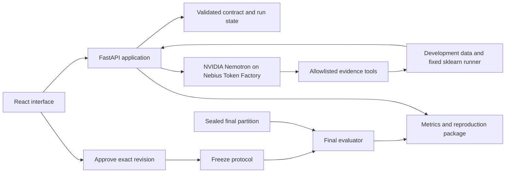

# Second Look

> October 16 update: preserved as the original specification and fallback. The current ambitious recommendation is [CounterLab](COUNTERLAB_PRD.md); see the [direct comparison](AMBITIOUS_IDEA_COMPARISON.md). No implementation has started.

## Product requirements document — v1.0

**Date:** October 15, 2026  
**Status:** Recommended project specification; implementation and setup have not started.  
**Entrant:** Solo builder, assisted by AI development tools.  
**Track:** Best Apps and Agents.  
**Submission deadline:** October 30, 2026, 10:00 a.m. PDT / 1:00 p.m. EDT.  
**Internal target:** Submit October 29.  
**Working tagline:** Before you trust the score, test the experiment.

Read alongside [research and decision](RESEARCH_AND_DECISION.md) and [delivery and evaluation plan](DELIVERY_AND_EVALUATION_PLAN.md). All numerical performance thresholds below are **targets, not achieved results**.

## 1. Product in one paragraph

Second Look is an experiment-review agent for AI learners and builders using its supported tabular experiment format. It takes a small dataset, a manifest for one of its fixed model recipes, and a statement of what must be predicted and when. NVIDIA Nemotron on Nebius Token Factory investigates whether the model is using information that would be unavailable at that moment or an evaluation split that fails to test the intended use. It gathers evidence through bounded Python tools, proposes a specific experiment change, obtains the user's approval, and reruns the experiment. The output is an understandable claim revision and a downloadable record someone else can reproduce.

The experiment-specific distinction is the connection between prediction moment, feature availability, evaluation policy, and the interpretation of a revised score. Investigate/approve/repair/verify workflows already exist in other tools. This product does not claim to invent that pattern.

## 2. User, problem, and promised outcome

### Primary user

An AI student or solo ML builder who can run a tabular model and read basic metrics but wants a second review before presenting the result. Initial use: preparing a portfolio experiment, prototype handoff, or internal technical review.

### Job to be done

“Before I present the score from this supported experiment, help me check whether it answers my intended prediction question, identify the evidence for any problem, and produce a corrected run I can explain.”

### Problem evidence and limits

Published work documents leakage across scientific fields and public notebooks; REFORMS calls for explicit study goals, feature legitimacy, and reproducible evaluation. This supports the need for careful experiment review. It does not establish demand for this particular interface. There are no recruited user interviews or usability trials in this plan. See the [evidence review](RESEARCH_AND_DECISION.md#3-research-that-changes-the-product-design).

### User outcome

The user can distinguish:

1. A measured score from a valid claim about the intended task.
2. A demonstrated violation from an unsupported suspicion.
3. A corrected protocol from a claimed improvement in predictive performance.

The output must state what was checked, what assumptions it relied on, what changed, and what remains unknown. The application never awards a universal “leak-free,” “scientifically valid,” or “production-ready” certificate.

## 3. The product's central demonstration

Start with an intentionally flawed experiment on public Bike Sharing data. The task is to predict rental count **before the hour begins**. The model has access to same-hour `casual` and `registered` counts. A high score may look impressive, but those values are unavailable at prediction time and together reconstruct the target.

The agent connects the declared task to data-dictionary evidence, requests a numerical check, and proposes excluding the invalid columns. The user reviews the exact change. The runner repeats the fixed experiment and displays the measured results and assumptions. A separate finding can explain why a random validation split does not test a future-demand claim.

No score is written into the story in advance. The apparent performance may fall; the important result is a supported correction to the claim. Feature removal is compared under a fixed development split. Changing the split is shown separately.

The same engine must also handle Bank Marketing's contact-duration feature under a before-call task, a clean case, and a case with missing timing information. The app must respond to changed inputs, rather than play a preset sequence.

Data semantics: [Bike Sharing](https://archive.ics.uci.edu/dataset/275/bike+sharing+dataset), [Bank Marketing](https://archive.ics.uci.edu/dataset/222/bank+marketing). Our flawed recipes are explicitly labeled demonstration experiments; the source datasets themselves are not being declared defective.

## 4. Scope

### P0 — required for submission

| Capability | Exact boundary |
| --- | --- |
| Guided prediction contract | Target, prediction moment, intended population/time setting, feature availability, and intended validation policy |
| Hosted examples | Bike Sharing and Bank Marketing, plus clean/ambiguous variants; editable contracts and feature selections |
| Reusable local input | A documented CSV + JSON manifest interface using the same engine; no dataset-name detection rules |
| Supported experiments | Single-table regression or binary classification; fixed scikit-learn estimator and preprocessing recipe |
| Availability review | Compare feature semantics/availability with the declared prediction moment; numerical target-reconstruction probe as supporting evidence |
| Temporal split review | For a future-prediction contract with a reliable time key, identify incompatible row allocation and propose the allowed chronological policy |
| Consequential agent loop | Nemotron drafts the contract from the user's description, chooses probes, reacts to observations, proposes allowed changes, and explains uncertainty |
| Approval and rerun | Visible manifest diff; approval before any changed experiment executes |
| Reproduction package | Contract, original/revised manifests, hashes, split IDs, environment, metrics, trace, source attribution, and execution instructions |
| Judge experience | Public working URL, no payment or API key required from judges, live run and clearly labeled saved example |

### P1 — only after P0 and evaluation pass

- Bounded browser CSV import for non-sensitive user data.
- Group-aware splitting for experiments intended to generalize to unseen entities.
- Read-only notebook-to-manifest assistance; any inferred fields require confirmation.

### Excluded from this submission

Arbitrary notebook or repository execution, general code repair, AutoML, hyperparameter search, foundation-model training, causal discovery, every leakage type, fairness certification, medical/financial deployment decisions, production monitoring, multiple collaborating agents, external web browsing during audits, GPU self-hosting, and mandatory Tavily integration.

Train-only preprocessing is built into the trusted runner. General detection and repair of preprocessing mistakes in arbitrary existing notebooks is outside P0.

## 5. Supported input contract

The interface asks ordinary questions first, with an expandable technical manifest. A model may suggest answers from the provided data dictionary; the user confirms them. Unknown remains an allowed value.

| Object | Required information |
| --- | --- |
| Dataset snapshot | Local CSV or allowlisted hosted dataset ID; content hash; column names/types; stable row IDs; source and license |
| Prediction contract | Target; regression/binary classification; what is predicted; prediction moment; time horizon if applicable; intended generalization; known limitations |
| Feature declarations | Meaning, source reference, availability relative to prediction time (`before`, `at`, `after`, `unknown`), and basis (`documented`, `user-declared`, `model-suggested`) |
| Original experiment | Feature list; estimator ID and fixed parameters; metric; seed; preprocessing recipe; original development split policy |
| Audit protocol | Development rows; sealed final rows if genuinely unused; allowed repair operations; immutable estimator/metric; test-history status |

P0 local limits: one CSV, at most 5 MB, 50,000 rows, and 50 columns. Numerical relationship probes inspect at most 30 numeric candidate features. Larger or unsupported inputs receive an explicit unsupported message. No expression evaluation, arbitrary file paths from hosted requests, user-supplied Python, or remote URL fetching.

**Supported estimator templates:** Ridge regression and logistic regression, using a fixed ColumnTransformer/Pipeline for numeric imputation/scaling and bounded categorical encoding. Use sparse-compatible fixed solvers (initial choices: Ridge `lsqr`, binary logistic `liblinear`), at most 32 encoded levels per categorical feature including a rare-category bucket, and at most 2,048 encoded columns overall. Limits and category grouping appear in the report. Non-convergence or a resource-limit failure is a failed run, not a score to present as complete. Parameters and library versions are pinned before evaluation. MAE is the primary regression metric; ROC-AUC is the primary binary-classification metric, with class counts and average precision reported for context. Undefined metrics are reported as undefined, not replaced silently. Each task also has a simple constant/dummy baseline.

Compatibility requires the original experiment to use these supported recipes and recorded settings. Mapping an unrelated model or notebook into a fixed recipe creates a new experiment; the app must not describe that as reproducing the user's original score. A historical score, if supplied, is labeled user-reported until the supported runner reproduces it. The hosted Bike/Bank originals are our constructed examples.

For the first Bike case, use calendar features known in advance and target-derived counts as the deliberate violation. Realized weather is excluded unless there is a documented forecast available at prediction time. No lag-feature engineering in P0. For Bank, use an explicitly documented limited feature set; do not assume that every campaign field existed before the call. The Bank demonstration tests feature availability and does not make a future-deployment claim from a random split.

## 6. User journey and interface

### Screen 1 — Choose an experiment

Two real-data example cards explain the prediction question and source. A “Use your data locally” link opens the supported input guide. A saved result is available for orientation and clearly marked with its creation time and version.

### Screen 2 — State the claim

The user confirms “What are we predicting?”, “When is the answer needed?”, and “Which information exists then?” Nemotron turns a short description and dictionary into a draft contract. The UI highlights unknown and suggested fields. The user can edit the task and feature availability before starting.

### Screen 3 — Investigation

A progress list shows concise actions: “Checking when these fields become available,” “Testing whether two fields reconstruct the answer,” and “Reviewing the evaluation split.” Each completed action links to evidence. This is a factual execution trace, not hidden model reasoning or an invented conversation between agents.

### Screen 4 — Review the finding

Each finding has four parts: what may be wrong, why it matters for this task, the supporting evidence, and the proposed change. Use these statuses:

- **Confirmed under the stated contract:** a check and the confirmed metadata support the finding.
- **Needs information:** availability or intended use is unresolved; no automatic repair.
- **No issue found in the completed checks:** does not imply all possible problems were ruled out.
- **Unsupported:** the experiment is outside the tool's supported scope.

### Screen 5 — Approve and compare

Show an exact before/after feature or split-policy diff. The main action is “Approve change and rerun.” The user may decline. Display development results with the estimator, metric, split identity, and changed variables visible. If the split changes, place results in distinct panels and explain that they answer different evaluation questions.

### Screen 6 — Freeze and export

The user confirms the fixed specification and, if an unused final test exists, selects “Freeze and evaluate once.” Show its provenance explicitly: **reserved before this product's fitting/selection**, **user-declared unused; external history unverified**, or **previously revealed**. Display the final result with a permanent “test revealed” state while preserving its earlier provenance. Export the complete record. Further changes create a new revision and label this test as already used. Hosted example results are labeled **illustrative/reused public-data evaluation** after first exposure; opening another session does not restore independence.

### Visual quality requirements

Readable typography, restrained color, direct labels, keyboard-accessible controls, visible focus, textual status alongside color, understandable loading/error states, and a usable layout at a 1280-pixel desktop width. Put raw JSON and technical traces behind expandable sections. Main evidence should fit on one screen without forcing the judge to read a long chat transcript.

## 7. Functional requirements and acceptance criteria

| ID | Requirement | Acceptance criterion |
| --- | --- | --- |
| F01 | Validate inputs | Missing target/time information is identified; unsupported columns, types, or limits fail with a useful message |
| F02 | Draft and confirm contract | Model-suggested availability never becomes a confirmed fact without evidence/user confirmation; unknown timing blocks a dependent repair |
| F03 | Run a live NVIDIA model | A fresh audit records the exact Nemotron model, Nebius request metadata, token use, and tool calls; a model outage cannot appear as a completed live audit |
| F04 | Investigate adaptively | Two schemas and a same-schema pair with different prediction moments produce appropriate evidence-dependent decisions; trace shows observations preceding the proposed change |
| F05 | Ground findings | Every confirmed finding references a contract field and valid evidence ID; numerical claims are inserted from tool output |
| F06 | Limit repairs | Only feature exclusion or an allowed chronological split revision may execute; target, metric, estimator, and hidden test membership cannot be changed by the model |
| F07 | Require approval | Declining a diff causes no revised execution; approval is tied to that exact manifest hash |
| F08 | Compare correctly | Fixed-split feature comparisons share estimator, parameters, seed, metric, train/dev rows, and preprocessing; split changes carry a non-comparable label |
| F09 | Protect final evaluation | Agent tools cannot read final labels or metrics before freeze; attempted access fails; exposure is tracked across sessions/revisions by dataset hash, target and final row IDs, so a revealed test cannot appear new |
| F10 | Reproduce results | Exported manifest and pinned runner reproduce deterministic metrics within a stated tolerance on the same data/version |
| F11 | Handle clean/unknown cases | Clean controls are not automatically changed; ambiguous availability produces an unresolved finding rather than an invented fact |
| F12 | Generalize within scope | Two public schemas and renamed-column fixtures use the same engine; a local custom CSV works without source-code edits |
| F13 | Survive common errors | Invalid model JSON, API timeout, rate limit, worker timeout, and empty/one-class partitions produce recoverable states |
| F14 | Preserve provenance | Reports distinguish source documentation, user declarations, model suggestions, deterministic observations, and measured outcomes |

## 8. Agent and tool design

Use one bounded agent, not a multi-agent framework. Nebius supports [function calling](https://docs.tokenfactory.nebius.com/ai-models-inference/function-calling); actual behavior must be tested with the chosen model during setup.

### Responsibilities

**Nemotron:** interpret task language; propose a contract; choose useful probes; connect evidence to the task; propose an allowed revision; request missing context; summarize the verified record.

**Python tools:** validate data/specifications; calculate statistics; verify supported invariants; allocate rows; fit the fixed model; compute metrics; enforce permissions; build the export.

**User:** confirm task assumptions and approve changes. The model is not the authority on undocumented feature availability.

### Tool inventory

| Tool | Input/output purpose | Boundary |
| --- | --- | --- |
| `inspect_schema` | Column types, missingness, dictionary entries | No raw personal rows in model context |
| `check_availability` | Compare confirmed feature timing with prediction moment | Unknown timing returns unresolved |
| `check_target_relation` | Equality or pairwise sum checks on development data | Bounded search; returns residual/tolerance/support, not a universal leakage verdict |
| `check_split_policy` | Compare row allocation and time order with the contract | No automatic finding merely because a date column exists |
| `run_development_experiment` | Metrics under an allowlisted specification | Development data only; fixed resource limits |
| `propose_revision` | Validated manifest diff and evidence references | Does not execute or approve the revision |
| `assemble_report` | Structured record from validated fields | Cannot invent evidence or metrics |

`evaluate_final` belongs to the application after user approval and freeze; it is **not an agent-callable tool**.

Maximum ten tool actions and six model requests per audit, including contract drafting and report narration. One schema-correction retry is permitted **within** the six-request budget. Allow one original development run and at most one revised development candidate. The nominal sequence can use schema inspection, availability/relationship/split probes, original run, revision proposal, approved revised run, and report assembly within this cap. Final evaluation is separately application-controlled. Hitting a limit returns partial findings with an explicit incomplete status. The app uses a fixed set of safe tools; documents and column descriptions are treated as data, never executable instructions.

## 9. Architecture

### Implementation choices for the later build

- React + TypeScript frontend; FastAPI/Pydantic backend; pandas/NumPy/scikit-learn for bounded CPU work.
- One application service serves the built frontend and API. A worker subprocess runs fixed templates with time/memory limits. SQLite records run state and artifact references; no Redis or vector database required.
- Local files store temporary artifacts; source/versioned public example results provide a stable saved example. Hosted user sessions do not become a public dataset.
- Server-side `NEBIUS_API_KEY`; the browser never receives the key. The model receives schema, dictionary excerpts, confirmed assumptions, and aggregate evidence, not complete datasets.
- Start by testing `nvidia/Nemotron-3_5-Lightning`. Compare a second available Nemotron model only on development cases if needed; freeze the selected model before final evaluation. Confirm exact live API ID and terms in the account.
- Use the [official Token Factory quickstart](https://docs.tokenfactory.nebius.com/quickstart) for the current API endpoint. NVIDIA calls must go through Nebius at runtime.
- No Nebius Sandbox dependency. The selected track uses Nemotron through Token Factory; application CPU hosting can be separate under the [FAQ](https://nebiusglobalaihackathon.devpost.com/details/faqs).

### Deployment gate

Choose and verify a CPU host during setup, including its sleep behavior, storage, secrets, and availability through December 15. Target a small instance with roughly 2 GB RAM, subject to profiling. Cloud credits must not be assumed to exist or to be funded by Token Factory credits. The hosting provider and any paid budget remain decisions for setup; no purchase is authorized by this PRD.

## 10. Scientific correctness

### Two different kinds of held-out evaluation

1. **Application challenge cases** test whether Second Look behaves correctly on withheld scenarios.
2. **An experiment's final data partition** estimates the fixed model's performance under its declared protocol.

Keeping one separate does not automatically protect the other.

### Experiment protocol

For controlled public demonstrations, reserve the final partition before any fitting or investigation. Development work uses only the remaining data. A typical chronological case uses the first 60% for training, next 20% for development, and last 20% for the final test; allocate complete timestamp groups together. Exact row IDs are frozen and hashed. Alternative policies require an explicit task justification.

The deliberately flawed “original” experiment is reproduced **inside the development pool**. This preserves final rows for the later fixed protocol. Mark it as our constructed demonstration, not a historical result published by the dataset authors.

For an imported experiment whose earlier fitting/tuning history is unknown, Second Look cannot create an untouched test by renaming a partition. Report “independence unverified”; require genuinely unused data for an independent final assessment. Otherwise export a reproducible re-evaluation with that limitation.

Availability and target-reconstruction probes use development data. Feature-only ablations keep row membership fixed. A split-policy correction changes the evaluation question and is reported separately. Freeze the final feature set, estimator, metric, seed, and splits before final scoring. No automatic repair loop after final reveal. Reproducing the same frozen run is allowed and labeled reproduction.

The final test is protected by application state, tool permissions, and separate evaluator inputs. Persist exposure status using **dataset snapshot hash + target + final row IDs**, across sessions and protocol revisions. Do not include the feature/model configuration in the exposure key: changing those does not create fresh test labels. If that history is lost, status becomes unverified, not unused. Public example partitions used during development or previous demonstrations remain labeled illustrative/reused even when the current agent cannot access them before its run completes.

This is an execution guarantee within the product, not a claim that a user with the source dataset cannot inspect it independently. Public datasets may also be familiar to pretrained models; they are demonstrations, not proof of unseen-domain generalization.

## 11. Evidence package

Export a ZIP containing:

- `report.md` and machine-readable `report.json` with findings, assumptions, limitations, and source links.
- `contract.json`, original/revised experiment manifests, and the exact approved diff.
- Dataset hash, stable row-ID allocations, selected columns, environment lock/version, seed, and metric definitions.
- Development and final results with distinct labels; timing, token usage, and estimated inference cost.
- Tool trace with request/observation IDs, excluding secrets and hidden model reasoning.
- Fixed reproduction entry point and instructions; data source/license information, with redistribution only as permitted.

Reports have an experiment fingerprint and version. A fingerprint supports reproducibility and change detection; it is not an independent certification or tamper-proof attestation.

## 12. Performance, reliability, and privacy targets

| Area | Release target |
| --- | --- |
| Responsiveness | First visible status within two seconds; progress during longer work |
| Runtime | Typical audit and development rerun within 90 seconds; explicit three-minute timeout |
| Worker | One active experiment per worker initially; bounded queue with honest wait state |
| Inference | Target average at or below $0.10 per complete audit, measured from actual usage |
| Reproducibility | Same pinned runner/data/spec yields metric difference at most 1e-6 for deterministic templates |
| Live reliability | Ten consecutive end-to-end example runs complete before recording/submission |
| Data handling | No full raw rows in model prompts; temporary local/hosted run artifacts expire after 24 hours unless exported |
| Access | Public judge path works in a fresh browser without a personal Nebius key or paid account |

Rates, latency, and resource needs are unmeasured. An API error is an error; the app may offer a saved example with a clear label, but must not present a cached response as a new live run. User-facing logs omit secrets. Downloaded CSV-like outputs are escaped against spreadsheet formula injection where relevant.

## 13. Evaluation and release gates

The detailed protocol is in [the evaluation plan](DELIVERY_AND_EVALUATION_PLAN.md#2-evaluation-protocol). Minimum evidence before making strong claims:

- Two public datasets through the same engine, plus controlled cases with known expected outcomes.
- Clean controls, unknown-availability cases, renamed columns, and conflicting/instruction-like metadata.
- All confirmed findings grounded in valid evidence references.
- No unapproved or out-of-scope changes executed.
- Measured detection precision/recall, clean-case false positives, justified abstentions, successful revisions, reproducibility, latency, and cost.
- A rules-only baseline, the same model without tools, and the full workflow; report each baseline's access to information.

Failing a threshold means publish the actual limitation, fix the cause if time allows, and reduce the supported scope when necessary. Never silently drop difficult cases or describe self-created scenarios as an independent public benchmark.

## 14. Judging strategy

| Equal-weight criterion | Evidence we will show |
| --- | --- |
| Technological implementation | Live Nemotron decisions on Nebius; validated tools; bounded corrections; repeatable execution; model/tool ablation |
| Design | One understandable task-to-report journey; a clear evidence card; readable comparison; graceful unresolved/error states |
| Potential impact | Published problem evidence; clear AI-builder audience; two real-data demonstrations; reusable local format; honest absence of user-demand validation |
| Quality of idea | A coherent experiment-claim review workflow; task-dependent reasoning; honest scope and explicit prior-art comparison |

The [organizer's criteria](https://nebiusglobalaihackathon.devpost.com/updates/46204-here-s-how-judging-works) are equal-weight. No feature-count target substitutes for a complete experience.

## 15. Submission compliance mapping

| Obligation | Planned evidence / action | Current status |
| --- | --- | --- |
| Eligible human entrant | Confirm age, residence and conflict restrictions | U.S. confirmed; remaining self-check pending |
| Working track-aligned project | Guided Best Apps and Agents workflow | Specified, unbuilt |
| Required runtime technology | Nemotron calls through Nebius Token Factory | Account and integration pending |
| Public working demo | Hosted URL with free judge access through December 15 | Hosting gate pending |
| Public code and license | Public repository, MIT or Apache-2.0 LICENSE, complete README and assets | Pending build |
| Demonstration video | Public YouTube, target 2:45–2:55, strictly under three minutes | Storyboard in delivery plan |
| English materials | Description, UI, README, captions/narration | Planned |
| Specific tool feedback | Actual onboarding, schema behavior, quality/cost, reproducible problems, improvements | Log during setup/build |
| Rights and attribution | Dataset notices and dependency licenses; record new work dates | Pending implementation |
| Clear sponsor use | Writeup, Built With, and spoken explanation in video | Planned |

Sources: [Official Rules](https://nebiusglobalaihackathon.devpost.com/rules), [FAQ](https://nebiusglobalaihackathon.devpost.com/details/faqs), [submission guidance](https://nebiusglobalaihackathon.devpost.com/updates/46205-how-to-build-a-winning-project). This matrix is a delivery checklist; eligibility is not yet confirmed.

Best Apps and Agents is the recommended track. We do not depend on the Coding track's ambiguous Token Factory code-execution wording. The entrant reported no qualifying city-event attendance, so the City Winner category is unavailable. The MVP has no Tavily call and does not target that bonus. Detailed, useful feedback remains mandatory and can also support the feedback award.

## 16. Open decisions and completion definition

Resolve during setup: account eligibility/access, actual credits, exact model behavior, package/runtime compatibility, CPU host and ongoing cost, and working-name availability. “Second Look” is a working title, not a cleared trademark or reserved domain.

Resolve during the first development spike: whether the model contributes useful task interpretation and investigation; whether both public cases complete within resource limits; whether the contract can be explained in a short demo.

**Definition of done:** all P0 requirements either pass with recorded evidence or are explicitly narrowed in the final specification; evaluation results are published with failures; the live demo, repository, attribution, video, and tool feedback are complete; a fresh-browser judge walkthrough works; the submitted entry accurately describes the implemented scope.

The goal is a strong, defensible submission. Winning remains a competitive judgment, not something this specification can guarantee.
