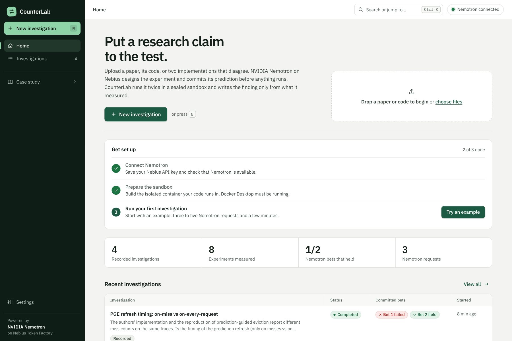
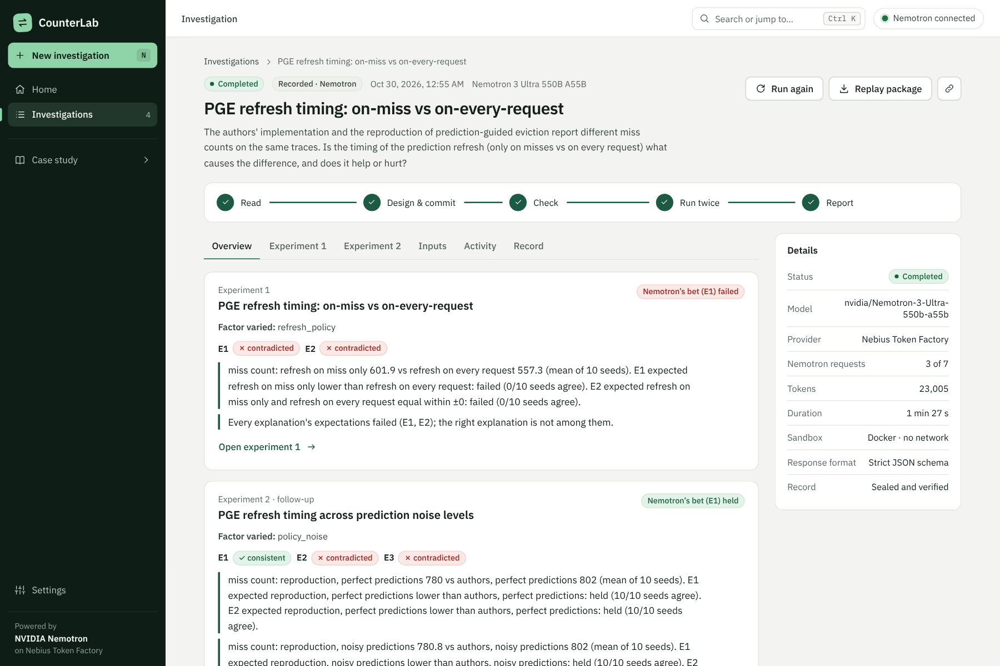
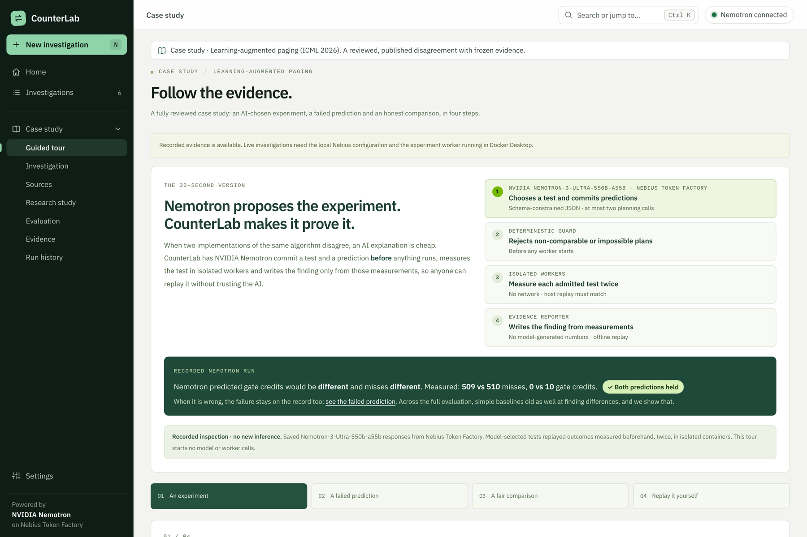
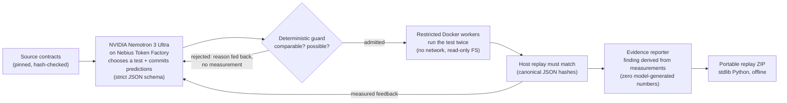
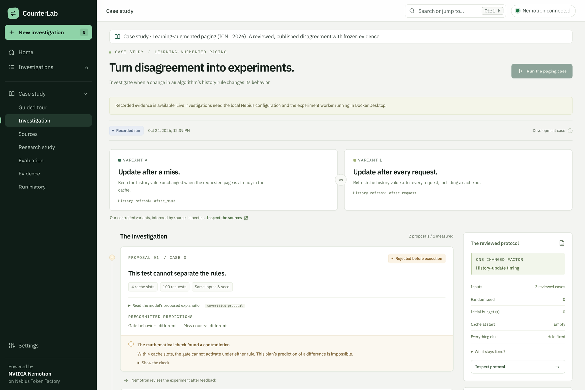
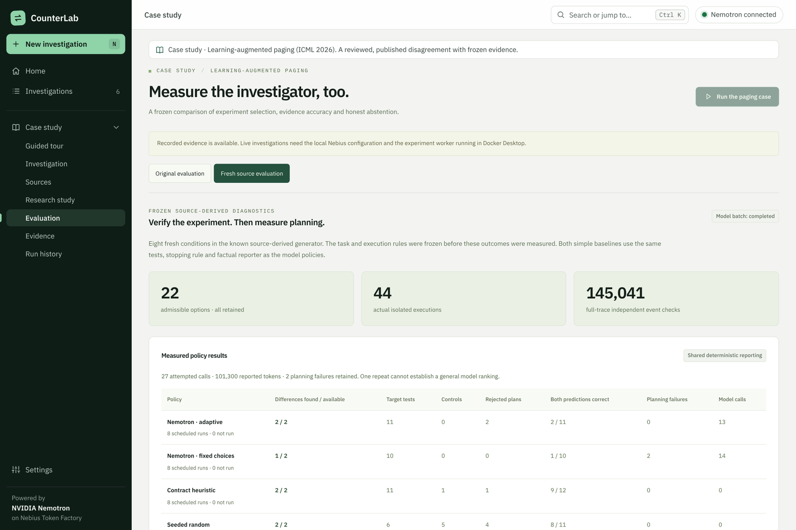
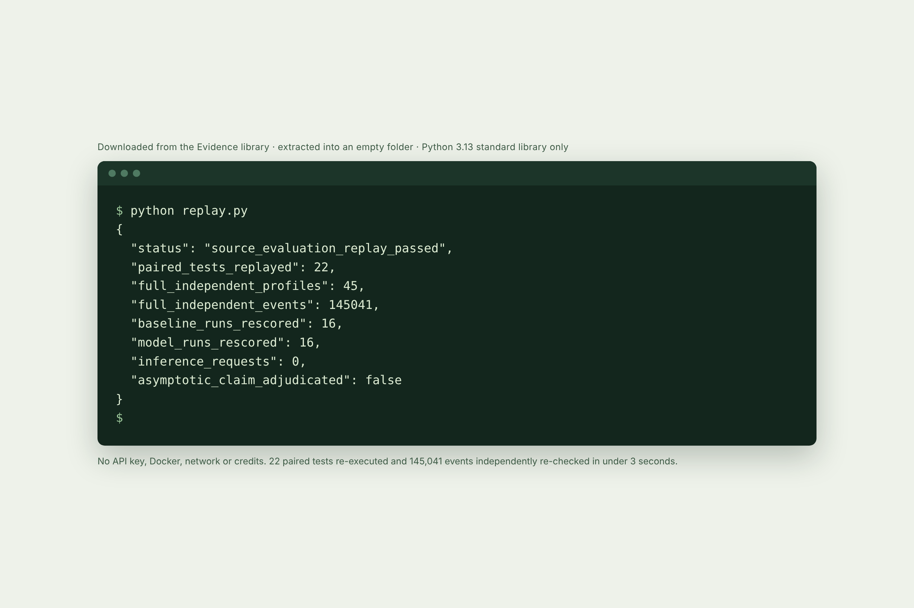

# CounterLab

**Turn research disagreement into experiments you can replay.**

Upload a paper, the code behind it, or two implementations that disagree. **NVIDIA Nemotron 3 Ultra,
running on Nebius Token Factory**, reads them, picks a claim it can test, names competing explanations
and what each one predicts, commits its bet, and writes the experiment code, all *before* anything
runs. CounterLab's deterministic guard checks the plan, runs your code twice in a sealed Docker
sandbox (no network, read-only, non-root) with paired seeds, and writes the finding from the
measurements. The model never writes a number in the report. Nemotron then designs one follow-up
from the measured results, and the whole investigation downloads as a package anyone can recheck
with standard-library Python.

Hackathon track: **Best Apps and Agents** (Nebius × NVIDIA Global AI Hackathon 2026).



| | |
| --- | --- |
| **Investigate your own paper or code** | [Quick start](#quick-start) (Python 3.13, Docker Desktop, a Nebius key) |
| **Try it with no key** | `python scripts/preview_open_lab.py`: the real sandbox with clearly labelled simulated planning |
| **See a fully reviewed case** | [Case study: learning-augmented paging](#case-study-learning-augmented-paging) and its frozen AI-vs-baseline evaluation |
| **Judge guide** | [submission/JUDGE_GUIDE.md](submission/JUDGE_GUIDE.md) |
| **Model and provider** | `nvidia/Nemotron-3-Ultra-550b-a55b` via `https://api.tokenfactory.nebius.com/v1/` |

## The problem

Reproductions disagree all the time, and the disagreement is rarely settled by argument. In
Hugging Face's [open reproduction effort for ICML 2026](https://huggingface.co/blog/icml-2026-open-reproductions),
independent teams reached **opposite verdicts on the same claims for 242 papers**. Asking an LLM
*why* a result doesn't reproduce produces a fluent explanation, but an explanation is not evidence.
A trustworthy investigator has to:

1. pick a test that actually separates the competing explanations, with everything else held fixed;
2. commit to a prediction before seeing the result;
3. run the test in a controlled environment and keep the result even when the prediction fails;
4. hand over evidence someone else can recompute without trusting the tool.

The audience is computational researchers, research engineers and reviewers who need to know whether
a reported result or difference is real, and under which conditions.

## What an investigation does



| Step | Who does it | What is guaranteed |
| --- | --- | --- |
| **Read** | CounterLab (`counterlab/open_lab/intake.py`) | PDFs (text-based), Markdown, LaTeX or text; Python files, ZIPs, GitHub repository or folder links, arXiv/OpenReview/PMLR links. Archive paths are normalised, symlinks and hidden folders dropped, sizes bounded. Documents are passed to the model as data, never as instructions. |
| **Design and commit** | **Nemotron 3 Ultra** via **Nebius Token Factory** | One strict-JSON-schema response: the claim (with a quote), the single factor varied, 2–4 conditions, 1–5 metrics, 3–12 shared seeds, 2–4 competing explanations each with the outcomes it expects, a bet, and a `measure(condition, seed)` harness. Saved and hashed before anything executes. |
| **Check** | Deterministic guard (`counterlab/open_lab/guard.py`) | Rejects designs whose explanations expect the same outcome (they can't be told apart), harnesses that ignore the uploaded Python, use the network, processes, `eval`/`exec`, deletion or interpreter internals, or ignore the seed or condition. Design-level problems get one redesign before commitment; harness problems get up to two repairs for the first experiment and one for the follow-up, with the predictions locked. |
| **Run twice** | Sandbox (`counterlab/open_lab/sandbox.py`, `runner.py`) | Docker with `--network=none`, read-only root, non-root user, no capabilities, CPU/memory/process/time limits, no host mounts and no credentials; inputs travel on stdin. CounterLab, not the harness, calls `measure()` for every condition × seed, then repeats the whole run; values must match exactly to be judged. |
| **Report** | Evidence reporter (`counterlab/open_lab/report.py`) | Per-condition mean, SD, min and max; each expectation judged held/failed/inconclusive with the seeds that agree and an exact sign test; explanations marked consistent or contradicted; the bet scored. Every sentence of the finding is assembled from these numbers. |
| **Follow up and replay** | Nemotron, then you | One follow-up experiment designed from CounterLab's measured summary, then a sealed record with SHA-256 manifest. The download re-verifies every hash and recomputes every finding offline (`python replay.py`), or re-executes the experiments (`--rerun`). |

Three bundled examples are ready to investigate: **two reservoir samplers that disagree** (an off-by-one bug
under-samples the first k items: measured 0.82× the expected rate against a theoretical 0.81×), **a
paper-only claim** about Welford's variance algorithm (Nemotron implements both methods from the
text), and **a cache-eviction disagreement** between the authors' code and a reproduction that differ
only in when a page's predicted next request is refreshed.
The first recorded investigation is a **live Nemotron run** (October 30, 2026, on the entrant's own
machine): Nemotron 3 Ultra on Nebius Token Factory, three model calls, 23,005 reported tokens, 87 seconds end to
end, no retries. Its first bet failed (refreshing on every request *reduced* misses, 557.3 vs 601.9
over 10 seeds). Its follow-up harness then crashed in the sandbox on all 40 measurements (a string-slicing bug).
CounterLab returned the traceback, Nemotron repaired the harness in four seconds, and the repaired
experiment ran and reproduced exactly; its follow-up bet held on 10/10 seeds. The other three recorded
examples are labelled **simulated planning**: their plans were written by us to exercise the pipeline,
while the sandbox runs, checks and reports are real.

**What it can run.** Python 3.13 with numpy, scipy, pandas, scikit-learn and networkx, on CPU, within
240 seconds per sandbox run; each admitted experiment is run twice. Code in other languages is read and re-implemented in Python, and
the record says so. GPU training, network services and very large repositories are out of scope; the
prompt lists files that did not fit by name.

## Case study: learning-augmented paging

Before building the open workflow, we investigated one real, published disagreement in depth:
**learning-augmented paging** (cache eviction with ML forecasts, from the ICML 2026 paper
[*Towards Optimal Robustness in Learning-Augmented Paging*](https://proceedings.mlr.press/v306/chen26gt.html)),
where the official code and a public reproduction differ in when the algorithm refreshes its history
value. This case has hand-reviewed adapters, a frozen evaluation of Nemotron against zero-inference
baselines and eight replay packages. Open it from **Case study** in the sidebar.



### How the case study runs



| Step | Who does it | What is guaranteed |
| --- | --- | --- |
| Propose | **Nemotron 3 Ultra** via **Nebius Token Factory** | Plan and predictions are saved *before* execution. At most two planning calls, no automatic retries, explicit output cap. |
| Admit | Deterministic guard (`counterlab/source_guard.py`) | Rejects tests that cannot isolate the question and predictions that contradict necessary mathematical conditions, using inputs only. A rejection is never counted as a measurement. |
| Measure | Isolated Docker workers (`worker/`) | Each admitted test runs twice as a non-root user with no network, a read-only filesystem, dropped capabilities and CPU, memory, process and time limits. A host replay must match (canonical JSON hashes). |
| Report | Evidence reporter (`counterlab/evidence_report.py`) | The finding cites every measurement, keeps nulls and controls, and states what remains unresolved. |
| Replay | You | The downloaded ZIP recomputes the measurements and the report with only Python's standard library. |

### What a run looks like



In this **recorded live run** (Nemotron 3 Ultra, three requests, 15,390 tokens, 21 s), the model's
first plan predicted a difference that is mathematically impossible on a 4-slot cache. The guard
rejected it **before any worker ran** and fed the reason back. Nemotron then chose a different test,
predicted both counts would differ, and the measurement confirmed it: 19 vs 18 misses and 1 vs 0 gate
credits.

The guided tour also shows a recorded case where Nemotron was **wrong** (it predicted a difference, and
both rules produced 636 misses). That failure stays in the record, next to the success.

### Results, including where the AI did *not* help

We evaluated whether the AI adds value instead of assuming it does. Eight frozen source-derived tasks,
two Nemotron planning policies and two zero-inference baselines used the same tests, stopping rule and
reporter:

| Policy | Finite differences found / available | Both predictions correct | Model calls |
| --- | ---: | ---: | ---: |
| Nemotron adaptive | 2 / 2 | 2 / 11 | 13 |
| Nemotron fixed choices | 1 / 2 | 1 / 10 | 14 |
| Contract heuristic | 2 / 2 | 9 / 12 | 0 |
| Seeded random | 2 / 2 | 8 / 11 | 0 |

- The model batch used 27 calls and 101,300 reported tokens with no retries. Every returned model ID was exactly `nvidia/Nemotron-3-Ultra-550b-a55b`.
- An independent full-trace oracle checked 45 profiles and 145,041 post-warmup events.
- **No selection advantage over the simple heuristic is established, and Nemotron's predictions were unreliable.** That finding is why the prediction guard exists: a retrospective, input-only review found 14 contradictory model plans. Truncated responses and wrong predictions remain in the evidence.
- Source reproduction: three selected aggregates from the supporting report (k=16, 150,000 requests, ten seeds) match exactly. Changing only history timing adds 247–285 misses in all ten paired seeds.

These are development diagnostics on one adapter and one synthetic generator, not a general model
ranking or a verdict on the paper's theorem. See [Limitations](#limitations).



### Recompute it yourself

Every number above ships with its evidence. Download a package from **Evidence → Evidence library**,
extract it into an empty folder and run `python replay.py`:



## Quick start

Requires Python 3.13 and, for new investigations, Docker Desktop and a Nebius Token Factory key.
From the project folder (Windows PowerShell; macOS/Linux use `python3.13` and `.venv/bin/python`):

```powershell
py -3.13 -m venv .venv
.\.venv\Scripts\python.exe -m pip install -r requirements-lock.txt
.\.venv\Scripts\python.exe scripts\start_app.py
```

The app opens at **http://127.0.0.1:8000/**. Everything else happens in the app:

1. **Settings → Nemotron connection.** Paste your Nebius Token Factory key and choose **Save and
   connect**. CounterLab stores it in the local `.env` file (it is never sent back to the browser),
   reads the model catalog to confirm `nvidia/Nemotron-3-Ultra-550b-a55b` is available, and lets you
   send one small structured test request.
2. **Settings → Sandbox → Set up sandbox** (Docker Desktop running). This builds and probes the
   isolated container once; `scripts\setup_open_runner.py` does the same from a terminal.
3. **New investigation** (or press <kbd>N</kbd>). Drop a paper and code, or start from an example;
   write the question, approve the credit use and start. The investigation page follows each step
   live; you can stop it at any time, and **Run again** reuses the exact same inputs.

A typical investigation makes three to five Nemotron requests (at most seven) and takes a few minutes.

**No key?** `python scripts\preview_open_lab.py` runs the same app with simulated planning for the
bundled examples and the real sandbox (add `--local` to skip Docker; that mode has no network
isolation; settings changes stay in a scratch file). `python scripts\start_app.py --read-only
--port 8001` opens every recorded investigation and the case study without credentials or Docker.

After a live run you are happy with, `python scripts\promote_open_run.py RUN_ID` copies its sealed
record into `cases/open_lab/recorded/`, so the hosted evidence edition shows it.

## The app

| Screen | What you do there |
| --- | --- |
| **Home** | Setup checklist, your numbers (investigations, experiments measured, how often the committed bet held), recent investigations, examples, and a drop zone that starts a new investigation with the files you drop. |
| **New investigation** | One form: the question, inputs (files, links, an example, or the inputs of an earlier run), output allowance, follow-up, consent. Validation explains what is missing next to the field. Readiness of Nemotron and the sandbox is shown before you start. |
| **Investigations** | Every run with status, committed bets, experiments measured and requests used; search (<kbd>/</kbd>) and status filters live in the URL, so a filtered list can be shared. |
| **Investigation** | A live progress rail (read → design and commit → check → run twice → report) with elapsed time and retry notices; tabs for the overview, each experiment (claim, committed explanations and bet, charts with every seed, verdicts, the code Nemotron wrote), inputs, activity (every Nemotron request, token counts and retries) and the sealed record. **Stop**, **Run again**, **Replay package** and **Copy link** are in the header. |
| **Settings** | Save, replace or remove the Nebius key; check the connection (no tokens); choose among the Nemotron models your catalog offers; send a test request; build the sandbox. |

<kbd>Ctrl</kbd>/<kbd>⌘</kbd> + <kbd>K</kbd> opens a command palette for pages, examples and recent
investigations. The interface follows Vercel's Web Interface Guidelines (keyboard operation, deep-linked
state, validation beside fields, loading and empty states, confirmation for destructive actions).

## Reliability of the Nemotron connection

- **Retries that match the official OpenAI SDK.** Connection errors, timeouts, HTTP 408, 409, 425, 429
  and 5xx are retried with exponential backoff and jitter (up to three retries per request), honouring
  the provider's `Retry-After`. Errors a retry cannot fix (400, 401, 402, 403, 404, 422) stop at once with
  a fixed code and a next step. Every retry is recorded in the investigation, and the page shows it live.
- **Response-format fallback.** If Token Factory rejects the strict JSON schema, CounterLab retries the
  same request with a relaxed schema and then JSON mode; every answer is still validated locally, and the
  record says which format was used.
- **Model fallback.** If the configured model is not in your catalog, the strongest available NVIDIA
  Nemotron model is used and named in the record.
- **Truncated or malformed designs** are re-asked once (with a doubled output allowance when truncated);
  nothing is committed or run from an incomplete answer.
- **Stop** abandons a pending request and shuts down a running sandbox within a second or two; whatever
  was committed or measured stays sealed and checkable. **Run again** reuses verified inputs exactly.
- Chat requests may take up to 15 minutes (reasoning plus a long harness); catalog reads 30 seconds.

### The case study's own live workflow

The paging case keeps its reviewed, narrower workflow: build its worker once with
`scripts\setup_worker.py`, then open **Case study → Research study → Source investigator**. A guarded
source run makes at most **two** Token Factory requests (8,192 output tokens each by default, no
retries). It checks that the exact model ID is in your account's catalog, stops for review if the
returned model differs, and turns provider refusals (for example HTTP 429 rate limiting) into a clear
next step without retrying. The open workflow retries temporary errors as described above.

A static, keyless **evidence edition** is also available (`npm --prefix web run build:judge`,
then `python scripts/build_judge_release.py`); see [submission/JUDGE_GUIDE.md](submission/JUDGE_GUIDE.md).

## How Nebius Token Factory and NVIDIA Nemotron are used

- **Runtime inference:** the Python backend (`counterlab/open_lab/service.py`, `counterlab/api.py`,
  `counterlab/source_planner_v2.py`, `scripts/check_nebius.py`) calls Token Factory's OpenAI-compatible
  `chat/completions` endpoint with `nvidia/Nemotron-3-Ultra-550b-a55b`.
- **What Nemotron does in an open investigation:** reads the paper text and code (a ranked excerpt
  plus an outline of every Python file), chooses the claim, writes competing explanations with their
  expected outcomes, commits a bet, writes the experiment harness, repairs it from sandbox tracebacks
  when it fails, and designs a follow-up from CounterLab's measured summary. Up to seven requests,
  16,384 output tokens each by default, a 15-minute timeout for reasoning plus code generation, and bounded automatic retries for temporary errors.
- **Structured output:** every response uses `response_format: json_schema` with `strict: true`
  (nested objects, enums and bounds) and is re-validated locally before anything is committed or run.
  In the case study, the allowed test IDs are an enum that excludes tests already tried.
- **Sampling:** temperature 1.0 and top_p 0.95, NVIDIA's recommended settings for Nemotron 3 Ultra.
- **Feedback loop:** a guard rejection or a measured result is returned to Nemotron as structured
  feedback for one follow-up choice.
- **Accounting:** requested and returned model IDs, finish reasons, token usage and elapsed time are
  saved with every run. Raw reasoning text is not stored. Cumulative reported use across development
  was 413,410 tokens over 79 calls.
- **Availability:** `nvidia/Nemotron-3-Ultra-550b-a55b` is not on Token Factory's
  [November 2026 serverless deprecation list](https://docs.tokenfactory.nebius.com/model-deprecations-november-2026.md)
  (checked October 27, 2026), so the live workflow should keep working through judging.
- Nebius AI Cloud compute and Tavily are **not** used: uploaded code runs in local restricted Docker
  containers.

Detailed feedback on both tools is in [submission/TOOL_FEEDBACK.md](submission/TOOL_FEEDBACK.md).

## Architecture

```text
counterlab/open_lab/  Open investigations: intake, resilient Nebius client, Nemotron planner, guard, sandbox, runner, report, records, settings, API
counterlab/        FastAPI app (api.py), case-study planners, guard, evidence reporter, record sealing/replay
worker/            Case-study Docker worker: allowlisted code only, no network, non-root
cases/open_lab/    Bundled examples and recorded open investigations (sealed, hash-checked)
cases/paging/      Case study: pinned source contracts, frozen protocols and recorded runs (hash-checked)
web/               React 19 + TypeScript + Vite app (src/lab/ = product screens; dist/ = local app, judge-dist/ = evidence edition)
scripts/           Launcher, readiness check, replays, evaluation and release tooling
tests/             Offline Python tests (no network, no credentials)
submission/        Judge guide, Devpost draft, tool feedback, validation logs, gallery images
docs/              README images and the earlier planning documents (docs/planning/)
```

Built with Nebius Token Factory, NVIDIA Nemotron 3 Ultra, Python 3.13, FastAPI, Pydantic, SQLite,
pypdf, Docker, React, TypeScript and Vite.

## Verification

```powershell
.\.venv\Scripts\python.exe scripts\fetch_reference.py --download   # optional pinned fixture, hash-checked
.\.venv\Scripts\python.exe -m unittest discover -s tests -v
npm.cmd --prefix web ci --ignore-scripts
npm.cmd --prefix web run test:all
npm.cmd --prefix web run build
```

The pre-live-run product validation passed **292 offline Python tests** (including a local fake Token Factory server
that exercises retries on 429/503/dropped connections/timeouts, the schema fallback, Stop and Run again,
and real Docker sandbox checks: no network, read-only root, non-root user; skipped when the runner image
is not built) and **25 frontend tests**, both production builds, a browser walkthrough of the whole
product flow (example → live progress → result tabs → replay download → Run again → Stop → filters →
Settings key, connection check and test request → command palette) and of both editions, and an
automated accessibility scan (axe-core, WCAG 2.2 AA rules) of 23 views and tabs at desktop and 390 px
phone width with no violations.
Automated provider tests use injected fakes or a local test server rather than paid inference.
The recorded live investigation is separate from those automated checks. Consult the validation
log for later tests and fixes; the milestone counts above are not a claim about a new run today. Release evidence is in
[submission/VALIDATION.md](submission/VALIDATION.md) and
[submission/FINAL_PROJECT_REVIEW.md](submission/FINAL_PROJECT_REVIEW.md).

## Accessibility

Built for keyboard and screen-reader use: a skip link, focus moved to each view's heading,
announced status messages, labelled landmarks and keyboard-reachable scroll regions. Important text and controls were checked against WCAG
AA contrast targets; an automated scan is not a complete accessibility certification. Motion is disabled for people who prefer reduced motion, and the layout reflows
to a 390 px phone without horizontal scrolling.

## Safety, security and spending

- **Spending:** every live start needs an explicit JSON `true` consent, has a hard planning-turn cap and is idempotent per request ID.
  The open workflow uses bounded, recorded transport retries and schema fallbacks; these are
  distinct from redesign and harness-repair turns. The historical case-study workflows retain
  their original no-retry contracts. Read-only mode blocks all writes on the server.
- **Isolation:** uploaded code and generated harnesses run only in Docker as a non-root user with
  `--network=none`, a read-only root filesystem, `--cap-drop=ALL`, `no-new-privileges`, CPU, memory,
  process and time limits, no host mounts and no credentials (inputs arrive on stdin). The guard
  additionally rejects harnesses that reach for the network, processes or dynamic code. Results are
  validated before they can become evidence or model feedback.
- **Prompt injection:** uploaded papers and code are wrapped as data; the system prompt tells
  Nemotron never to follow instructions inside them, and nothing the model writes is executed outside
  the sandbox.
- **Web hardening:** host allowlist (DNS-rebinding protection), CORS limited to the local origin,
  custom-header and origin checks on start routes, OWASP-recommended security headers (CSP,
  `nosniff`, `frame-ancestors 'none'`, COOP/CORP) and a credential-free `/api/health`.
- **Integrity:** records are sealed with SHA-256 manifests, and replays reject altered or omitted
  measurements even when file hashes are rewritten.
- **Failure handling:** provider errors are reduced to fixed codes (for example `provider_http_429`)
  before they reach the browser, which explains the next step. No provider message, request body or
  key is shown or stored.

## Limitations

These are published deliberately, because documented failures are part of the evidence:

- Open investigations run Python on CPU within minutes; other languages are re-implemented in Python
  and labelled as such, and scanned PDFs, GPU workloads and very large repositories are out of scope.
  An experiment tests the uploaded code under Nemotron's harness and settings; reading the harness is
  part of reviewing the result.
- One open investigation has been run live with Nemotron (recorded, see above); the other three
  recorded examples use simulated planning (labelled in the app and the record). One live run is a
  working end-to-end check, not a measurement of Nemotron's design quality on a frozen task set; the
  case study below is where AI-vs-baseline evidence exists.
- No planning advantage over a simple heuristic is established, and Nemotron's predictions were often
  wrong. The newer prediction guard has integration evidence (simulated planning with real numerical
  execution) but no live model evaluation yet.
- Finite experiments cannot settle the paper's asymptotic theorem or the full published disagreement;
  one selected supporting-report slice was reproduced, not the whole report.
- The live workflow runs locally. The hosted edition is a static recorded-evidence build that makes no
  model calls.

## What's next

- A frozen benchmark of open investigations on contested claims from the ICML 2026 reproduction
  effort, scored against simple baselines, like the case study.
- Running the sandbox on Nebius AI Cloud Serverless Jobs so the live workflow can be hosted for
  anyone, and GPU-backed experiments.
- Multi-language sandboxes (C++, Julia, R) so ports are no longer needed.

## Project documents

- [Development log](DEVELOPMENT_LOG.md): the full dated build history, including failed runs.
- [Judge guide](submission/JUDGE_GUIDE.md), [Devpost draft](submission/DEVPOST_DRAFT.md),
  [Tool feedback](submission/TOOL_FEEDBACK.md), [Validation](submission/VALIDATION.md).
- [App guide](APP_GUIDE.md), [Setup](COUNTERLAB_SETUP.md), [PRD](COUNTERLAB_PRD.md),
  [Source audit](cases/paging/SOURCE_AUDIT.md), [Countdown](PROJECT_COUNTDOWN.md).
- Earlier idea comparison and preparation notes: [docs/planning/](docs/planning/).

## License

Our code is MIT licensed ([LICENSE](LICENSE)). Third-party material is excluded from that grant; see
[THIRD_PARTY_NOTICES.md](THIRD_PARTY_NOTICES.md). The full upstream numeric artifact is not
redistributed. `scripts/fetch_reference.py` retrieves and hash-checks it only on explicit request.
